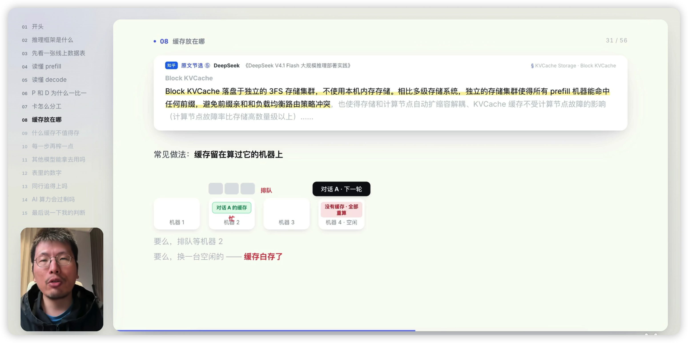
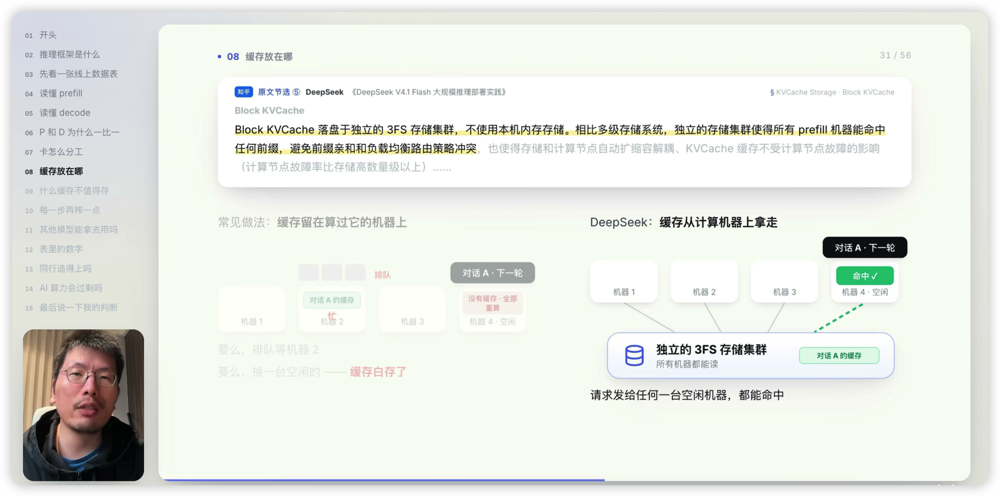

DeepSeek's Infra team is strong. It can achieve fast tps, a high cache hit rate, and low prices. After reading [“Super-agent 设计探索：迈向更自主的 Agent 系统” (Super-agent Design Exploration: Toward a More Autonomous Agent System)](https://mp.weixin.qq.com/s/zoS7GlReWPhfCjENGxXCdg), I saw traces of Infra in DeepSeek's Super Agent too.

The phrase that stayed with me from the article was “compute-storage separation” (存算分离), because I had run into the concept a few days earlier while learning [DeepInfer](https://github.com/deepseek-ai/deepinfer). Super Agent's compute-storage separation solves the problem that the Agent stops running when the laptop lid closes. Right now, when the lid closes, the Agent stops because three things live on the same device: the Agent loop, the Session record, and the execution environment.

## Super Agent's Compute-Storage Separation

In Super Agent's compute-storage separation, “compute” means running the Agent loop. We give the model a Prompt, and the model “computes” a result and returns it to us. “Storage” means the Session record: the Prompts we send to the model and the responses the model returns make up the Session record. That record contains what the Agent is doing at each step, what we sent in, and what the Agent gave back.

As long as we can move the running Agent loop and the Session record off the laptop, the Agent can keep working when the lid closes. The task just cannot run on the laptop anymore; it has to run in another execution environment. That is the idea behind cloud Agents.

## DeepInfer's Compute-Storage Separation

DeepInfer's compute-storage separation separates computing the KV Cache from storing it, both of which used to happen on the same machine.

The Bilibili creator 第四种黑猩猩CHIMP explains this part clearly in [the video “DeepSeek 一张卡为什么能收入 38 美元” (Why One DeepSeek Card Can Earn 38 Dollars), at the 13:01 mark](https://www.bilibili.com/video/BV13cxv6SE9L/?share_source=copy_web&vd_source=24ed93f7fced9c489a756910270aff5e&t=781). I will try to describe it in words here.

If compute and storage are not separated, as in [Figure 1](#fig-1), the KV Cache is tied to one machine. When the next request arrives, that machine may still be busy and have no time for the new request. Then the request has to find another machine. But that new machine does not store the KV Cache either, so it cannot hit the cache.

<figure id="fig-1">
  
  <figcaption>Figure 1: The cache stays on the machine that computed it</figcaption>
</figure>

So we separate compute and storage, as in [Figure 2](#fig-2). We store the KV Cache in a separate place, so it is not tied to one machine. Whoever wants to use it can call it directly, and new requests no longer have to queue and wait.

<figure id="fig-2">
  
  <figcaption>Figure 2: The cache is taken off the computer</figcaption>
</figure>

## Thoughts

Both kinds of compute-storage separation split apart something that was originally tied to one device. DeepInfer does this to provide model inference at scale. Could Super Agent be doing it to provide cloud Agents at scale?
