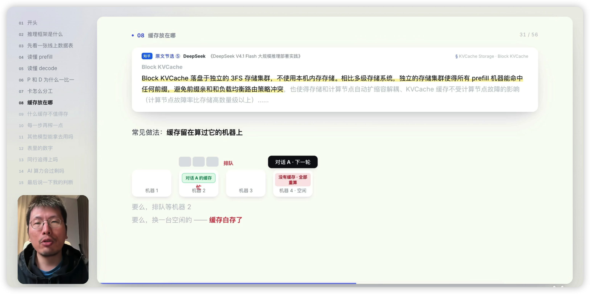
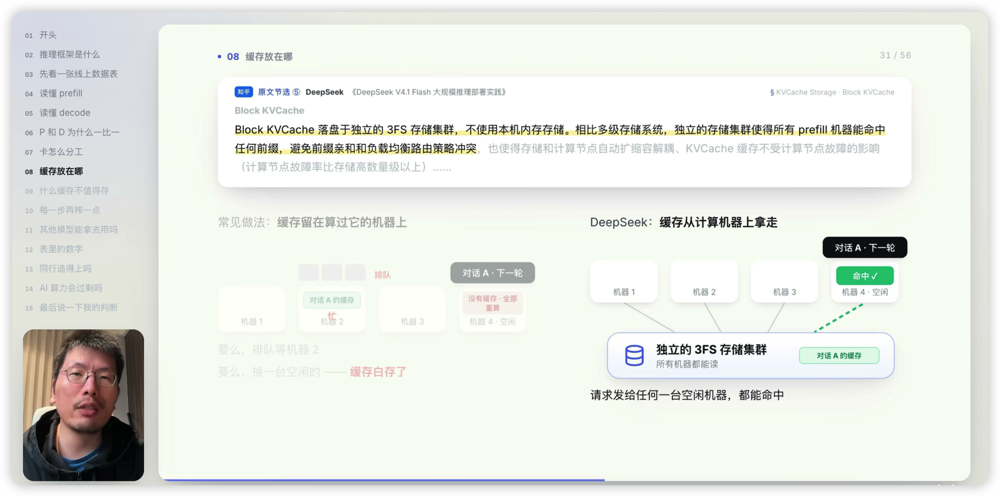

Deepseek 的 Infra 团队是很强的，能做到 tps 快，缓存命中率高，价格低。阅读完[《Super-agent 设计探索：迈向更自主的 Agent 系统》](https://mp.weixin.qq.com/s/zoS7GlReWPhfCjENGxXCdg)文章后，我在 Deepseek 的 Super Agent 身上也看到了 Infra 的痕迹。

文章让我印象比较深的是“存算分离”这四个字，因为在前几天学习 [DeepInfer](https://github.com/deepseek-ai/deepinfer) 的时候就有遇到过这个概念。Super Agent 讲的存算分离是为了解决当笔记本合上盖后，Agent 就不能跑的问题。当前，笔记本合上盖后 Agent 就不能跑，是因为 Agent Loop 的运行、 Session 的记录、执行环境这三者，在同一个设备上。

## Super Agent 的存算分离

Super Agent 存算分离的“算”，指的是 Agent Loop 的运行。也就是我们输入 Prompt 给模型，模型“算”出结果返回给我们；“存”指的是 Session 的记录，我们输入给模型的 Prompt，模型返回的内容组成了 Session 的记录，这个 Session 记录包含了 Agent 每一步在做什么，我们向 Agent 输入了什么，Agent 给出什么样的输出。

只要我们能够把 Agent Loop 的运行 和 Session 的记录从笔记本上拿走，那么当笔记本合上的时候，Agent 就可以继续工作。只是任务不能在笔记本上跑了，要在另外一个执行环境里跑，云端 Agent 的思路就是这样。

## DeepInfer 的存算分离

DeepInfer 的存算分离指的是将计算 KV Cache 和存储 KV Cache 在同一台机器上分开。

这一部分B站UP主第四种黑猩猩CHIMP的[视频《DeepSeek 一张卡为什么能收入 38 美元》在视频进度 13:01 的部分](https://www.bilibili.com/video/BV13cxv6SE9L/?share_source=copy_web&vd_source=24ed93f7fced9c489a756910270aff5e&t=781)讲的比较清晰，我在这里尝试用文字描述一下。

如果存算不分离，就像[图 1](#fig-1) 的情况，KV Cache 绑定在一台机器上的话，当下个请求过来时，有可能这个机器还在忙，没空搭理这个新的请求。那这时候这个请求就只能再找一个新的机器，可是这个新的机器又没存储 KV Cache，那就命中不了缓存了。

<figure id="fig-1">
  
  <figcaption>图 1 ：缓存留在算过它的机器上</figcaption>
</figure>

所以我们把存算分离，就像[图 2](#fig-2) 的情况，把 KV Cache 单独存储在一个地方，不要让 KV Cache 绑定在一台机器上。谁想用就直接调用，新的请求过来就不用排队等待了。

<figure id="fig-2">
  
  <figcaption>图 2 ：缓存从计算机上拿走</figcaption>
</figure>

## 思考

这两种存算分离，都是把原本绑定在一台设备的东西，拆开来。DeepInfer 这样做，是为了大规模提供模型推理的服务。Super Agent 这样做，会是为了大规模提供云端 Agent 的服务吗？